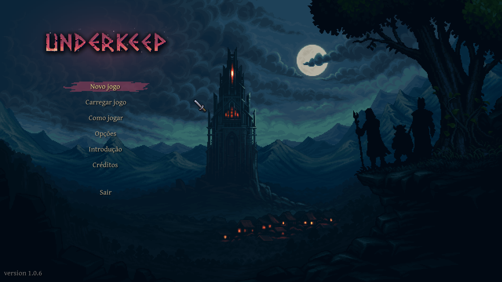
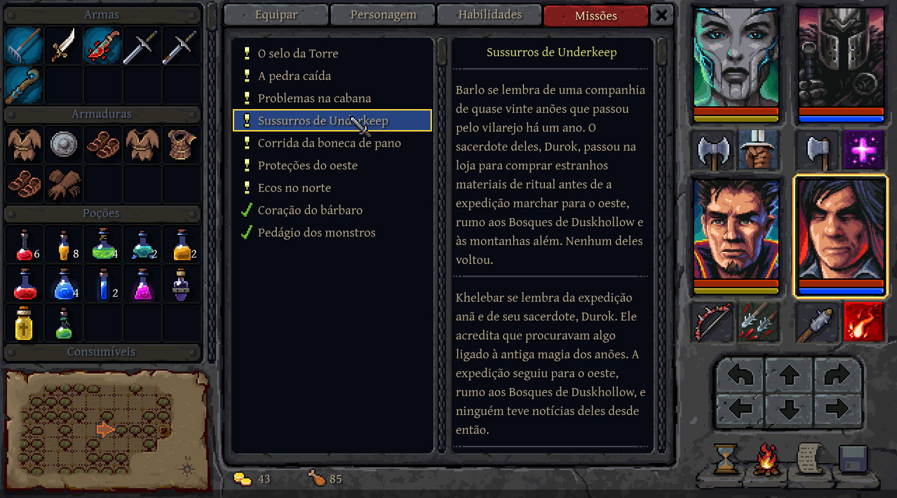
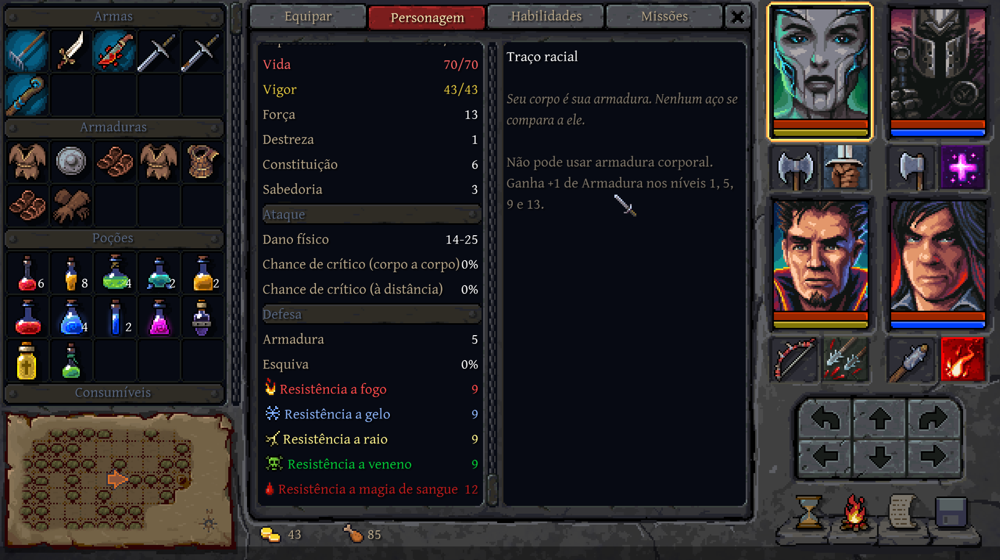
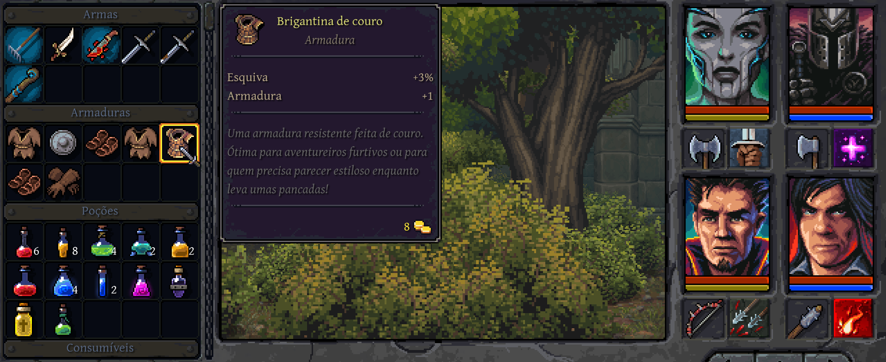

# Underkeep PT-BR

**Tradução comunitária, gratuita e não oficial do [Underkeep](https://store.steampowered.com/app/2411200/) para o
português brasileiro.**

Underkeep é um RPG de exploração de masmorras criado pela **Rake in Grass**. Este projeto nasceu do carinho pelo jogo e
quer que mais jogadores brasileiros possam aproveitá-lo por inteiro na sua língua: diálogos, narração, enigmas, itens,
habilidades e interface.

> **Aviso:** este é um projeto independente de fãs. Não é afiliado, patrocinado nem endossado pela Rake in Grass.
> Todos os direitos sobre o Underkeep pertencem aos seus criadores. Para jogar, é preciso ter o jogo original
> **comprado na Steam**. Nenhum arquivo do jogo é distribuído aqui. Veja o [aviso legal](AVISO_LEGAL.md).

> [!IMPORTANT]
> **Underkeep 1.0.6 (19/11/2026):** a Beta 2 foi feita para a versão 1.0.5 do jogo e **não é compatível com a
> atualização 1.0.6**. Se ela estiver instalada, **desinstale-a antes de jogar**. Uma nova versão está em
> preparação. Detalhes em [docs/ATUALIZACAO_1.0.6.md](docs/ATUALIZACAO_1.0.6.md).

**Ir direto para:** [Screenshots](#screenshots) · [Download](#download) · [Instalar no Windows](#instalação-no-windows) ·
[Instalar no Steam Deck](#instalação-no-steam-deck) · [Ativar o português](#como-jogar-em-português) ·
[Desinstalar](#desinstalar) · [Reportar erros](#reportar-erros-e-sugerir-melhorias) · [Contribuir](#como-contribuir)

## Screenshots

<table>
  <tr>
    <td align="center" width="50%">
       
      <b>Menu principal</b> traduzido (Underkeep 1.0.6)
    </td>
    <td align="center" width="50%">
       
      <b>Missões e narrativa</b>: diário com os relatos dos personagens
    </td>
  </tr>
  <tr>
    <td align="center" width="50%">
       
      <b>Ficha do personagem</b>: atributos, resistências e traços
    </td>
    <td align="center" width="50%">
       
      <b>Itens e equipamentos</b>: inventário e descrições
    </td>
  </tr>
</table>

Capturas de tela feitas por jogadores com a tradução instalada. O menu principal mostra o Underkeep 1.0.6 (build
26770834); as outras três foram feitas na versão 1.0.5 (build 26592006). As imagens mostram conteúdo do Underkeep ©
Rake in Grass e não são cobertas pelas licenças deste projeto.

## Status

| | |
|---|---|
| Versão da tradução | **0.1.0-beta.2**, primeira beta pública, publicada em 16/11/2026 ([baixar](../../releases/tag/v0.1.0-beta.2)) |
| Cobertura | **5.786 de 5.786** textos traduzíveis (100%) |
| Próxima versão | **0.1.0-beta.3**, para o Underkeep 1.0.6 (build 26770834), **em preparação e ainda não publicada**. 5.796 de 5.796 textos traduzíveis; instalação e jogo já testados pelo mantenedor no Windows e no Steam Deck |
| Revisão editorial | **em andamento**: a tradução está completa, mas a revisão humana e o playtest de todos os caminhos ainda não terminaram |
| Versão do jogo | Underkeep na Steam, **build 26592006** (versão 1.0.5, atualização de 13/11/2026). Outras builds são recusadas pelo instalador. A 1.0.6 (build 26770834) ainda não é suportada: veja [a nota de atualização](docs/ATUALIZACAO_1.0.6.md) |

| Categoria | Textos | Cobertura |
|---|---|---|
| Diálogos e narrativa | 3.531 | 100% |
| Interface | 1.102 | 100% do traduzível |
| Itens | 838 | 100% do traduzível |
| Habilidades | 315 | 100% |

"Cobertura completa" significa que todo texto do jogo tem tradução. Isso não quer dizer que todo texto já foi revisado
e testado em jogo. Erros de tradução, quebras de layout e inconsistências ainda podem aparecer: sua ajuda para
encontrá-los é bem-vinda.

### Plataformas

| Plataforma | Situação |
|---|---|
| Windows 11 (64 bits) | **Testado:** instalador `.exe`, tradução jogada e desinstalação com retorno ao espanhol original |
| Steam Deck / SteamOS (Proton) | **Testado na beta.2:** janela de instalação no modo Desktop (`kdialog`), detecção automática do jogo e do prefixo Proton, tradução jogada, bloqueio com o jogo aberto e desinstalação. Sem `sudo` e sem instalar Python |
| Windows 10 | Não testado (deve funcionar como no Windows 11) |
| Outras distribuições Linux | Não testado |

Resultados detalhados: [docs/VALIDACAO_BETA2.md](docs/VALIDACAO_BETA2.md).

## Download

Os pacotes ficam na página de **[Releases](../../releases)** deste repositório. Se você nunca usou o GitHub: clique em
**Releases**, no lado direito da página, abra a versão mais recente e, em **Assets**, baixe o ZIP da sua plataforma.

| Pacote | Para quem |
|---|---|
| `Underkeep-PTBR-v0.1.0-beta.2-Windows.zip` | Windows (não precisa de Python) |
| `Underkeep-PTBR-v0.1.0-beta.2-SteamDeck.zip` | Steam Deck no modo Desktop (usa o Python que já vem no SteamOS) |

Cada pacote vem com um arquivo `.sha256` para você conferir o download. Nenhum deles contém arquivos do jogo: a
tradução é gerada no seu computador, a partir da sua própria instalação. Baixe somente da página oficial do projeto.

## Instalação no Windows

1. Abra o Underkeep pela Steam **pelo menos uma vez** e feche o jogo.
2. Extraia o ZIP inteiro numa pasta qualquer.
3. Execute **`Instalar-Underkeep-PTBR.exe`**, confirme a pasta do jogo (detectada automaticamente) e responda `s`.
4. No jogo, abra **Opções → Idioma** e escolha **Español**: esse idioma passa a exibir o português.

O instalador:
- usa os arquivos do **seu** jogo para gerar a versão traduzida;
- grava apenas em `Documentos\Underkeep\mods\base`;
- **não altera** a pasta da Steam, o executável, os saves, a Steam Cloud nem as configurações;
- recusa versões incompatíveis do jogo, o jogo aberto e pastas de outros mods.

Os executáveis não têm assinatura digital, então o SmartScreen pode avisar. Detalhes, opções avançadas e solução de
problemas: [docs/INSTALACAO.md](docs/INSTALACAO.md).

## Instalação no Steam Deck

1. No modo Jogo, abra o Underkeep **pelo menos uma vez** e feche o jogo.
2. Mude para o **modo Desktop** e extraia o ZIP inteiro (Dolphin: botão direito → Extrair → Extrair aqui).
3. Dê dois cliques em **`Instalador-Underkeep-PTBR.sh`** e, se o sistema perguntar, escolha **Executar**.
4. Escolha **Instalar a tradução**, confira as pastas mostradas e confirme. A geração leva alguns minutos.
5. Volte ao modo Jogo e escolha **Español** no menu de idiomas.

Não precisa de `sudo`, senha nem instalar programas. A tradução fica em `Documents/Underkeep/mods/base`, dentro do
prefixo Proton do jogo. O instalador encontra a pasta sozinho, inclusive com o jogo no cartão microSD, e pergunta
quando há mais de uma opção.

Passo a passo, modo terminal e solução de problemas: [docs/STEAM_DECK.md](docs/STEAM_DECK.md).

## Como jogar em português

Depois de instalar, abra o jogo e vá em **Opções → Idioma → Español**. A tradução ocupa o lugar do espanhol, então o
menu continua mostrando "Español", mas os textos aparecem em português.

## Desinstalar

Feche o jogo antes.

- **Windows:** execute **`Desinstalar-Underkeep-PTBR.exe`**.
- **Steam Deck:** abra o `Instalador-Underkeep-PTBR.sh` e escolha **Desinstalar a tradução**.

O desinstalador remove só a pasta criada pelo instalador, depois de conferir que ela não foi modificada. O espanhol
original volta a funcionar.

> **Quando a Steam atualizar o Underkeep, desinstale a tradução** e aguarde uma versão compatível. A tradução
> instalada contém uma cópia dos dados da versão anterior do jogo.

## Limitações conhecidas

- A tradução ocupa o lugar do **espanhol**: enquanto estiver instalada, o espanhol original não fica disponível.
- Cada versão da tradução funciona com **uma build específica** do jogo. Após atualizações, é preciso esperar uma
  nova versão da tradução.
- Revisão humana completa e playtest de todos os finais ainda em andamento. Alguns textos podem ficar longos demais
  para o espaço disponível.
- Os executáveis do Windows **não têm assinatura digital**: o SmartScreen pode exibir um aviso. Confira o SHA-256.
- São necessários cerca de **800 MB livres** durante a instalação. Ao final, ficam cerca de 370 MB em Documentos.
  Se a sua pasta Documentos é sincronizada (por exemplo, pelo OneDrive), esses arquivos também serão sincronizados.
- Créditos, nomes de idiomas e textos técnicos permanecem como no original.

## Reportar erros e sugerir melhorias

Use a aba **[Issues](../../issues)** deste repositório e escolha um modelo:

- **Problema de tradução**: erro, frase estranha, termo inconsistente ou texto cortado.
- **Bug técnico**: falha na instalação, desinstalação ou no carregamento.
- **Sugestão de melhoria**: ideias para o projeto.

Informe a versão da tradução, a plataforma, o local do jogo onde o texto aparece e, se puder, uma captura de tela.
**Não anexe saves, arquivos do jogo ou dados pessoais.**

## Como contribuir

Contribuições de revisão, sugestões de tradução e testes são muito bem-vindas. Leia:

- [CONTRIBUTING.md](CONTRIBUTING.md): como abrir issues e pull requests;
- [docs/CONTRIBUINDO_TRADUCOES.md](docs/CONTRIBUINDO_TRADUCOES.md): catálogo, estados de revisão, testes e validador;
- [docs/GUIA_DE_LOCALIZACAO.md](docs/GUIA_DE_LOCALIZACAO.md) e [docs/GLOSSARIO.md](docs/GLOSSARIO.md): regras
  editoriais e terminologia.

Documentação técnica (ferramentas, pack-sombra, geração de releases): [docs/DESENVOLVIMENTO.md](docs/DESENVOLVIMENTO.md).
Fluxo de trabalho e VS Code: [docs/FLUXO_DE_TRABALHO.md](docs/FLUXO_DE_TRABALHO.md).
Mapa de toda a documentação: [docs/README.md](docs/README.md).

## Créditos

- **Underkeep** © Rake in Grass. Obrigado por criar este jogo. Se gostou, apoie os desenvolvedores comprando-o e
  recomendando-o.
- **Tradução e ferramentas:** comunidade Underkeep PT-BR.
- **Uso de inteligência artificial:** o primeiro rascunho das traduções e parte das ferramentas foram produzidos com
  auxílio de IA (Claude, da Anthropic), sempre sob supervisão humana. Glossário, decisões editoriais, validação e
  playtests foram conduzidos e aprovados por pessoas. A revisão humana completa continua em andamento.

## Licença

| Material | Licença |
|---|---|
| Código-fonte próprio (`ukloc/`, `scripts/`, `tests/`, `release/`) | [MIT](LICENSE) |
| Traduções em português (`l10n/`) e documentação autoral | [CC BY-NC-SA 4.0](LICENSE-TRADUCAO.md) |

Essas licenças valem **somente** para o material criado por este projeto e **não concedem nenhum direito** sobre o
Underkeep, seus textos originais, nomes ou assets. Como toda tradução é derivada da obra original, elas também não
substituem uma autorização da Rake in Grass. Detalhes e limites: [LICENSE-TRADUCAO.md](LICENSE-TRADUCAO.md) e
[docs/LICENCIAMENTO_E_PUBLICACAO.md](docs/LICENCIAMENTO_E_PUBLICACAO.md).

## Titulares de direitos

Este é um projeto gratuito, comunitário, independente e não oficial. Ele **não** tem autorização da Rake in Grass, e a
ausência de objeções não é tratada como autorização. Se você representa os titulares dos direitos do Underkeep e quer
pedir alterações, créditos diferentes ou a retirada do conteúdo:
- abra uma issue com o modelo **[Solicitação de titular de direitos](../../issues/new/choose)**; ou
- escreva para o mantenedor pelo perfil do GitHub, se preferir um contato privado.

Os pedidos são tratados com prioridade e atendidos.

*Rights holders: this is a free, unofficial fan project with no authorization from Rake in Grass. To request changes
or removal, please open a "Rights holder request" issue or contact the maintainer through their GitHub profile.
Requests will be handled promptly.*
